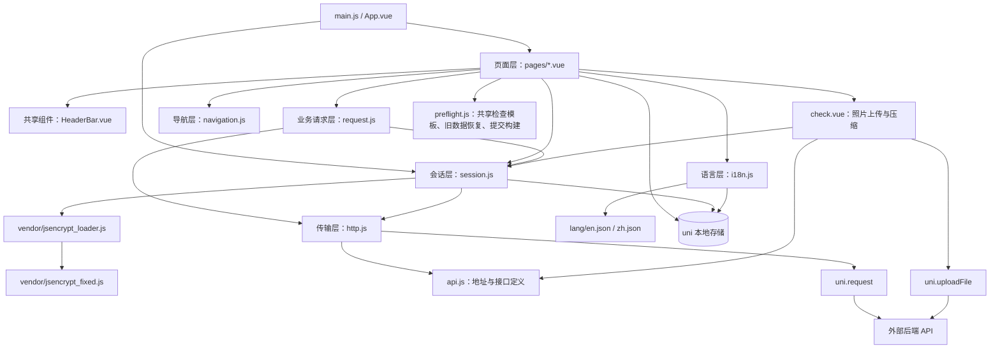

# 项目结构与架构

返回：[文档入口](./README.md)

## 1. 项目定位与技术栈

项目是面向无人机运维人员的飞前检查客户端。业务以 `ground_daily` 范围的人工检查、照片留存、草稿续填和历史查询为中心。当前源码没有直接控制无人机、拉取飞行遥测或播放 RTSP 视频的实现。

| 项目 | 源码依据与当前状态 |
| --- | --- |
| 应用框架 | uni-app；页面使用单文件 Vue 组件和 Options API |
| Vue 版本 | `manifest.json` 的 `vueVersion` 为 `3`；`main.js` 同时保留 Vue 2 条件编译分支 |
| 平台 | 有 App、H5、小程序、Harmony 配置；Android 存在运行配置和 APK 产物，其他平台可用性未实测 |
| 构建配置 | `vite.config.js` 使用 `@dcloudio/vite-plugin-uni`；另保留 `vue.config.js` 的 Webpack 配置 |
| 状态管理 | 页面 `data/computed/watch`、`uni` 本地存储及全局语言事件；未见 Vuex/Pinia 接入 |
| 网络 | JSON 请求使用 `uni.request`；照片使用 `uni.uploadFile` |
| 认证 | access/refresh token、Bearer 请求头、JWT payload 读取、JSEncrypt 登录密码加密 |
| 国际化 | 自定义 `common/i18n.js`，支持 `zh/en`，默认 `en` |
| 资源 | 检查示例 PNG、Tab 图标、代码生成的 SVG Data URI |
| 依赖管理 | 当前目录无 `package.json` 和锁文件，不能从此目录还原完整依赖版本与 CLI 命令 |

## 2. 目录结构

```text
A2ZApp/
├── main.js                          # Vue 初始化，注册 $t/$getLang/$setLang
├── App.vue                          # 应用生命周期、登录态检查、Tab 文案
├── pages.json                       # 7 个页面与 3 个 Tab 配置
├── manifest.json                    # 应用版本、平台能力、权限、图标、Vue 版本
├── index.html                       # H5 容器，另加载 jsencrypt.js
├── vite.config.js                   # H5 开发服务、代理、uni 插件、构建配置
├── vue.config.js                    # 兼容保留的 Webpack 配置
├── uni.scss                         # uni-app 样式变量
├── uni.promisify.adaptor.js          # Vue 2 分支使用的 Promise 适配
├── common/
│   ├── api.js                       # 默认服务地址、API 路径、图片源格式化
│   ├── constants.js                 # 存储键、路由、事件、校验、检查参数、公钥
│   ├── http.js                      # URL/query 组装、请求去重、uni.request
│   ├── request.js                   # 鉴权头、刷新、401 处理、业务响应解包
│   ├── session.js                   # 登录/刷新/退出、token 存取、密码加密
│   ├── preflight.js                 # 16 项共享模板、旧草稿合并、提交数据构建
│   ├── navigation.js                # 导航并发控制、重试、短时导航保护
│   ├── i18n.js                      # 语言读写、翻译查找、lang:changed 事件
│   ├── lang/{en,zh}.json            # 中英文文案
│   └── vendor/
│       ├── jsencrypt_loader.js      # 引入 fixed 文件并兼容查找构造器
│       ├── jsencrypt_fixed.js       # session 实际加载链路中的第三方实现
│       ├── jsencrypt.js             # H5 index.html 另行加载
│       └── jsencrypt_es.js          # 当前应用模块未见直接引用
├── components/
│   └── HeaderBar.vue                # Logo、通知占位、语言切换、状态栏适配
├── pages/
│   ├── login/login.vue              # 账号/密码/验证码、记住密码、语言切换
│   ├── index/index.vue              # 首页：新建检查、查看历史
│   ├── preflightSelectDrone/
│   │   └── preflightSelectDrone.vue # 无人机解析、搜索、选择与确认
│   ├── check/check.vue              # 16 项检查、照片、草稿、提交、离开拦截
│   ├── preflightHistory/
│   │   └── preflightHistory.vue     # 服务端分页历史、本地草稿、ID 筛选
│   ├── preflightHistoryDetail/
│   │   └── preflightHistoryDetail.vue # 详情、照片预览、删除记录
│   └── settings/settings.vue        # 用户资料、头像预览、退出登录
├── static/
│   ├── check/*.png                  # 11 项检查示例图
│   └── *.png                        # Logo、首页图和 Tab 图标
├── harmony-configs/                 # 当前扫描为空目录
├── .hbuilderx/launch.json            # uni-app Android 真机运行配置
├── .gitignore                       # 忽略 node_modules/unpackage/.hbuilderx 等
├── unpackage/
│   ├── cache/                       # 编译缓存、运行资源等生成内容
│   └── release/apk/                 # 按环境命名的 Android 安装包
├── tests/preflight.test.mjs          # 检查项调整与兼容回归测试
└── doc/                             # 项目分析文档
```

## 3. 分层与依赖



`request.js` 承担受保护 JSON 请求的统一处理；`session.js` 直接调用 `http.js` 完成认证接口，避免刷新接口再进入鉴权刷新流程。照片上传有独立的 token 检查、401 重试和响应解析逻辑，并不经过 `request.js`。

## 4. 模块职责与入口

| 模块 | 关键入口 | 职责 |
| --- | --- | --- |
| `App.vue` | `onLaunch`、`onShow` | 初始化语言，更新 Tab 文案，检查 access + refresh token，刷新失败清会话并跳登录 |
| `session.js` | `login`、`refreshTokens`、`logout`、`ensureFreshAccessToken` | RSA 加密、会话存取、过期判断、共享刷新 Promise |
| `request.js` | `request`、`requestGet`、`requestPost` | 注入 Authorization/lang、发送前刷新、401 后刷新重试、HTTP/业务错误归一 |
| `http.js` | `httpRequest` | 拼接服务地址和排序 query，按 method + URL + data 合并进行中请求 |
| `navigation.js` | `safeSwitchTab`、`safeNavigateTo`、`safeReLaunch` | 防重复导航、锁冲突重试；部分导航设置 450 ms 保护窗口 |
| `i18n.js` | `getLang`、`setLang`、`t`、`onLangChange` | 语言持久化、事件广播、平铺 key 或嵌套路径翻译 |
| `preflight.js` | `createPreflightSteps`、`restorePreflightDraft`、`buildPreflightItems` | 统一填写/历史顺序，合并旧电机/桨叶数据，构建 16 项提交 |
| `check.vue` | `markStep`、`saveDraft`、`uploadOne`、`doSubmitPreflight` | 检查状态、原生返回拦截、照片压缩上传、本地草稿与最终提交 |

检查模板和数据映射已提取到 `common/preflight.js`。其余核心业务仍集中在 `check.vue`，包括页面展示、草稿读写、上传鉴权和图片压缩；后续扩展检查类型时，这一集中结构仍是主要维护成本来源。

## 5. 启动、认证与页面生命周期

1. `main.js` 创建应用并注册翻译方法；Vue 3 分支调用 `createSSRApp(App)`。
2. `App.onLaunch` 初始化语言并订阅语言事件；`pages.json` 首页面是首页。
3. `App.onShow` 要求 access token 和 refresh token 同时存在；缺失时重启到登录页。
4. token 齐全时调用 `ensureFreshAccessToken`；若当前仍在登录页且刷新/检查成功，则切到首页。
5. 首页、检查、历史、详情和设置还会在各自 `onShow` 检查 access token。无人机选择页没有相同的显式页面级检查，依靠应用层及受保护请求处理。
6. 页面普遍订阅 `lang:changed` 并在卸载时解除订阅；检查页额外在 `onReady` 绑定原生返回与草稿定时器，在 `onUnload` 清理。

`onLaunch/onShow` 是应用生命周期，页面 `onShow` 是页面生命周期；源码中两层认证处理并存，不应假定其异步完成顺序。

## 6. 环境与构建配置

| 配置 | 当前值 / 行为 |
| --- | --- |
| 客户端默认服务地址 | `common/api.js`：`https://gcs.a2zd.co` |
| H5 本地代理条件 | localhost / 127.0.0.1 / 0.0.0.0，或端口 5173 / 8080；匹配时 API base 返回空字符串 |
| Vite 默认代理目标 | `http://172.24.26.170:5001`；可由 `VITE_API_TARGET` 覆盖 |
| Vite 监听地址 | `HOST` → `VITE_HOST` → `127.0.0.1` |
| Vite 端口 | `PORT` → `VITE_PORT` → `5173`；`strictPort: false` |
| `/dev-api` 重写 | `VITE_PROXY_STRIP_DEV_API=1`，或代理目标包含 `5001` 时，移除该前缀 |
| 其他代理路径 | `/socket.io`、`/sso`、`/imgs`、`/video`、`/flightops-api` |
| 应用版本 | `manifest.json`：`versionName=1.0.0`、`versionCode=100` |

生产 App 的请求会组合默认服务地址与 `/dev-api/...`。本地 H5 请求由 Vite 代理转发；若使用默认目标，后端收到的是移除 `/dev-api` 的路径。生产 H5 只有满足代码中的运行环境判断才走同源路径，其他情况下仍使用默认服务地址。

`STORAGE_KEYS.apiBaseUrl` 只是已定义的键，`getApiBaseUrl()` 没有读取该键，设置本地同名值不会切换环境。源码中注释保留了多套环境地址，APK 目录也按环境区分，但这些产物命名不能证明当前源码对应某个安装包内容。

代理支持 `/socket.io` 不代表已实现实时通信；当前页面及公共业务模块未发现 Socket.IO/WebSocket 客户端接入。

由于缺少依赖清单，不给出未经验证的 `npm install` / `npm run` 启动命令。可以结合 `.hbuilderx/launch.json` 在具备相应 uni-app 工具链的 HBuilderX 环境核查运行；CLI 构建需先补齐实际依赖与脚本。

## 7. 源码定位

| 主题 | 文件与分析时行号 |
| --- | --- |
| 创建应用与翻译注册 | [main.js](../main.js)，1、19 |
| 生命周期认证 | [App.vue](../App.vue)，29、38 |
| 页面/Tab 注册 | [pages.json](../pages.json)，2、59 |
| 路由常量 | [common/constants.js](../common/constants.js)，67 |
| 默认地址与 H5 代理判断 | [common/api.js](../common/api.js)，16、32、57 |
| 代理配置 | [vite.config.js](../vite.config.js)，1、50 |
| 检查页生命周期 | [pages/check/check.vue](../pages/check/check.vue)，546、594 |
