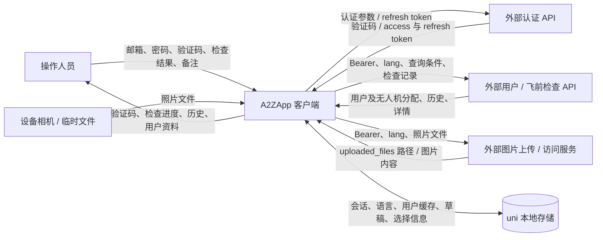
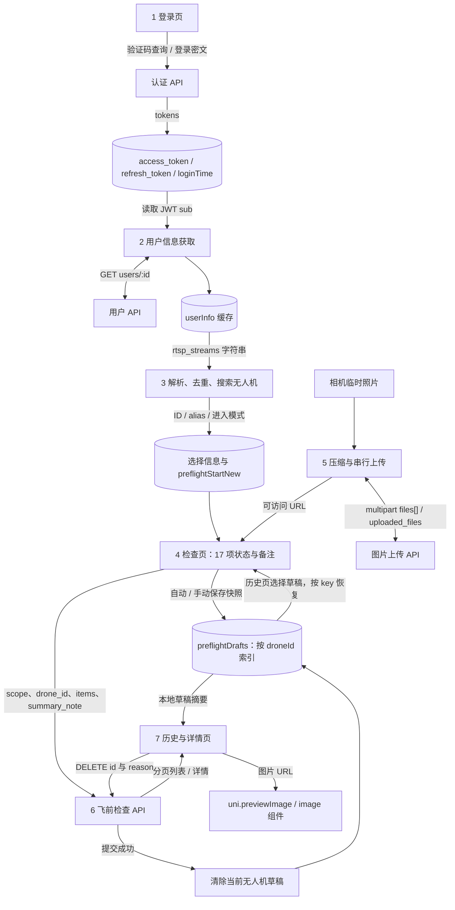
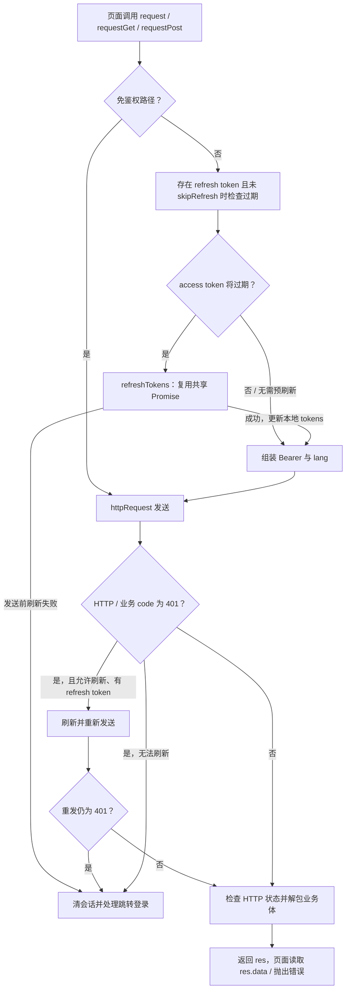
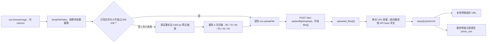

# 数据流、数据模型与接口

返回：[文档入口](./README.md)

## 1. 系统上下文数据流

下图按前端能够观察到的数据边界绘制。图中的后端和图片服务可能由同一部署提供，当前源码不足以判断其内部拆分与持久化方式。



## 2. 业务内部数据流



已提交历史来自服务端查询；本地草稿来自 `preflightDrafts`，两者在历史页并列展示，并没有合并为同一持久化记录。`preflightHistory` 存储键和 `PREFLIGHT.maxHistoryCount` 当前没有接入业务读写。

## 3. JSON 请求链路



图展示主要路径；实现还有 `catch` 中的 401 重试分支，不能据此认定所有错误路径都严格只重试一次。

请求细节：

- 免鉴权路径为登录、刷新、退出和验证码；使用 `startsWith` 匹配。普通业务请求加入 `Authorization: Bearer <access_token>` 和 `lang`。
- `ensureFreshAccessToken()` 默认提前 60 秒判断 JWT `exp`；无法得到有效 `exp` 时，有登录时间则按约 23 小时判断；没有登录时间则返回“未临近过期”。JWT 解码只读取 payload，不验证签名。
- `refreshTokens()` 用模块级 `refreshPromise` 合并同时发生的刷新请求。
- `httpRequest()` 用 method + 排序后的 URL/query + 稳定序列化 data 构建去重键；默认启用，headers 未进入键。进行中映射最多保留 100 项，超限移除最早映射，不代表取消对应网络请求。
- HTTP 成功回调只代表拿到响应；HTTP 错误和业务错误主要由上层检查。
- `request.js` 只在同时存在 `code` 和 `data` 时解包业务体，接受 `code=200/201/0`；其他 code 映射为错误。`session.js` 自己的解包只接受 `200`，两层规则不完全一致。
- `onUnauthorized` 可以替代默认的过期提示与登录导航；`skipRefresh` 跳过刷新，不会自动省略 Bearer/lang。

## 4. 无人机来源与转换

选择页优先使用页面内用户信息或本地 `userInfo`；缺失时从 JWT payload 的 `sub` 获取用户 ID，再请求用户接口。当前没有独立无人机列表接口。

`parseAssignedDrones()` 对 `userInfo.rtsp_streams` 按逗号拆记录，再按 `=` 拆字段：

```text
输入形态（示意）：id=字段1=abbr=alias,id=字段1=abbr=alias
取值：id = segs[0]，abbr = segs[2]，alias = segs[3]
输出：[{ id, abbr, alias }, ...]，按 id 去重
```

搜索在客户端对 ID、缩写和别名执行不区分大小写的包含匹配；“分页”也是对完整数组切片，每页 500 条，不是服务端分页。字段名称虽然含 `rtsp`，当前这里只用于解析分配信息，不会建立视频连接。

## 5. 检查模板与校验

模板写在 `check.vue` 的 `steps` 内，当前范围固定为 `ground_daily`。详情页另有相同 key 顺序的 `stepMetas`，并非动态读取模板接口。

| 顺序 | item_key / key | 检查项 | 照片必需 |
| --- | --- | --- | --- |
| 1 | `airframeOk` | 机身、机臂与起落架 | 是 |
| 2 | `contactsOk` | 机臂充电触点 | 是 |
| 3 | `motorOk` | 电机 | 是 |
| 4 | `propellerOk` | 桨叶/机体完好 | 是 |
| 5 | `upperCoverOk` | 上盖 | 是 |
| 6 | `antennaOk` | 4G、数传天线 | 是 |
| 7 | `landingCameraOk` | 精准降落相机 | 是 |
| 8 | `aerialCameraOk` | 航拍相机 | 是 |
| 9 | `lidarOk` | 激光雷达 | 是 |
| 10 | `parachuteOk` | 降落伞救援系统 | 否 |
| 11 | `winchOk` | 绞盘绳索与挂钩 | 是 |
| 12 | `batteryOk` | 电量/电池状态正常 | 是 |
| 13 | `routerOk` | 4G/5G 路由器 | 否 |
| 14 | `remoteServerOk` | 远程穿透服务器 | 否 |
| 15 | `dockOk` | 自动停机坪位置 | 否 |
| 16 | `rtkOk` | RTK 基站 | 否 |
| 17 | `remoteServerM2MOk` | 远程穿透服务器（仅 M2M 路由器） | 否 |

单项 `ok` 初始为 `null`，选择结果后是 `true/false`。`flowCompleted` 只表示每项均已选择结果，允许含不通过项；不等同于全部通过。页面中的总结果展示读取后端 `passed`，当前前端不提交总 `passed` 字段，也不能确认后端总结果计算规则。

11 项要求照片，每项最多 10 张。标记结果、下一项和进入汇总时有照片检查；最终提交方法没有再次统一检查所有必拍项，具体风险见[核查建议](./04-findings.md)。

## 6. 照片数据流



500 KiB 和 1600 px 是尽力压缩目标，不是硬性上传校验；文件已足够小时会直接返回，压缩失败时也可能沿用原文件。多个文件压缩和上传均按循环串行执行。

图片先上传、记录后提交。草稿中存的是上传后的 URL；这不是完整离线采集队列。删除单项照片只删除前端数组中的引用，未见远程图片删除接口调用；放弃检查或部分上传失败后的文件清理依赖后端机制，当前无法确认。

图片展示通过 `<image>` 和 `uni.previewImage` 加载 URL，未经过 `request.js` 的鉴权头注入；图片资源访问权限需要与服务端实际配置核对。

## 7. 数据模型

以下表示前端对象和接口载荷，不是数据库表结构。

### 7.1 页面检查状态

```javascript
{
  selectedDroneId: 'drone-id',
  selectedDroneAlias: 'drone-alias',
  currentStepIndex: 0,
  flowView: 'steps', // 或 summary
  draft: { note: '' },
  steps: [{
    key: 'airframeOk', labelKey: '...', descKey: '...',
    photoRequired: true, ok: null, note: '', photoUrls: []
  }]
}
```

### 7.2 本地草稿快照

```javascript
// uni storage: preflightDrafts[droneId]
{
  v: 1,
  droneId: 'drone-id',
  droneAlias: 'drone-alias',
  currentStepIndex: 0,
  flowView: 'steps',
  draft: { note: '' },
  steps: [{ key: 'airframeOk', ok: true, note: '', photoUrls: ['https://example.invalid/photo.jpg'] }],
  ts: 0 // 保存时的 Date.now()
}
```

每个无人机 ID 只保留一个快照；没有账号或环境命名空间。保存入口包括手动、每 3 秒内容变化检测、`onHide` 和离开确认。自动保存指纹不含 `ts`，避免未变更内容持续写盘；恢复时按 key 匹配当前模板、保留当前模板元数据，并把照片数截到 10 张。

### 7.3 提交请求

```javascript
{
  scope: 'ground_daily',
  drone_id: 'drone-id',
  summary_note: '',
  items: [{ item_key: 'airframeOk', ok: true, note: '', photo_urls: ['https://example.invalid/photo.jpg'] }]
}
```

`labelKey/descKey/photoRequired` 不随记录提交。提交前把 `ok` 转成布尔值；提交成功清除当前无人机草稿，并切回历史 Tab。防重复依赖当前页面提交锁和 JSON 指纹，未见向后端传递幂等键。

### 7.4 历史和详情转换

| 来源字段 | 页面字段 / 转换 |
| --- | --- |
| `list[].id` | 历史记录 ID |
| `create_time` | `Date.parse()` → 毫秒 `ts`，再按设备本地时区展示 |
| `passed` | `Boolean()` → 总结果 |
| `drone_id` | `droneId` |
| `photo_count` | `photoCount`，当前历史模板未显示此值 |
| `summary_note` | 详情 `note` |
| `items[].item_key` 或 `key` | 详情按 key 建立 `items` 和 `itemNotes` 映射 |
| `items[].photo_urls` | 补全 URL 后汇总为详情照片列表，当前不按检查项分组展示 |

## 8. 接口清单

路径按源码保留 `/dev-api`；本地代理可能移除此前缀。业务体允许直返或包装形式，但各调用链兼容规则存在差异。

| 方法 | 路径 | 输入 / 前端使用的输出 | 接入状态 |
| --- | --- | --- | --- |
| GET | `/dev-api/auth/getCaptcha` | `_ts`；读取 `captcha_id`、`captcha_image_url` 或 `captcha_image` | 登录页使用，免鉴权 |
| POST | `/dev-api/auth/login` | `email/password/captchaId/captchaCode`；`access_token/refresh_token` | `session.login` 使用，password 为 RSA 密文 |
| POST | `/dev-api/auth/refresh` | `refresh_token`；新 token | `refreshTokens` 使用，免鉴权 |
| POST | `/dev-api/auth/logout` | `refresh_token` | 设置退出使用，免鉴权 |
| GET | `/dev-api/users/:id` | JWT `sub` 作为 ID；用户资料和 `rtsp_streams` | 登录后、设置、选择页使用 |
| POST | `/dev-api/preflight/upload` | multipart `files[]`；`uploaded_files` | 检查页独立上传链路 |
| POST | `/dev-api/preflight/checks` | 上述提交对象；接口注释为 `id/create_time` | 检查页提交；成功回调未读取记录 ID |
| GET | `/dev-api/preflight/checks` | `page/pageSize/drone_id?`；`list/total` | 历史页每页 10 条，触底加载 |
| GET | `/dev-api/preflight/checks/:id` | ID；记录及 `items` | 详情页使用 |
| DELETE | `/dev-api/preflight/checks/:id` | query `reason=''` | 详情确认后调用；注释称软删除，服务端实现未核验 |
| GET | `/dev-api/preflight/templates/active` | 注释约定 `scope` | 仅定义，当前无调用 |
| POST | `/dev-api/form/upload` | 注释约定 multipart `files[]` | 仅定义，当前无调用 |

列表接口注释还约定 `passed/date_from/date_to`，当前页面没有传递这些条件。当前 UI 筛选仅作用于服务端历史中的无人机 ID；本地草稿摘要不按该筛选过滤。

## 9. 本地存储与事件

| 存储键 | 写入 / 使用 | 清理与注意事项 |
| --- | --- | --- |
| `lang` | i18n 持久化语言 | `clearSession()` 不清理 |
| `access_token`、`refresh_token`、`loginTime` | session 保存 token 和登录时间 | `clearSession()` 清理 |
| `userInfo` | 登录后、设置或选择页获取资料后缓存 | 登录发请求前和 `clearSession()` 清理 |
| `rememberPassword`、`rememberedEmail`、`rememberedPassword` | 登录页记住密码功能 | 取消勾选删除邮箱/密码；密码直接以原始字符串保存，退出不清理 |
| `preflightSelectedDroneId`、`preflightSelectedDroneAlias` | 选择页和历史恢复草稿时写入 | 作为跨页共享选择；退出不清理 |
| `preflightStartNew` | 选择页写 `'1'`；恢复草稿写 `'draft'` | 检查页消费后删除；缺少标记不会自动恢复草稿 |
| `preflightDrafts` | 无人机 ID → 草稿快照 | 提交成功或历史页删除草稿时删除对应项；退出不清理 |
| `apiBaseUrl`、`preflightHistory` | constants 中定义 | 当前未发现业务读写接入 |

语言切换：`setLang()` → 写 `lang` → `uni.$emit('lang:changed', next)` → 页面更新本地 `lang` 以触发翻译重算，App 尝试更新 Tab 文案。语言事件是当前主要全局事件通信；选择无人机与恢复草稿使用本地存储传递状态。

## 10. 源码定位

| 主题 | 文件与分析时行号 |
| --- | --- |
| 请求去重、URL 拼装 | [common/http.js](../common/http.js)，3、42 |
| 业务响应与鉴权重试 | [common/request.js](../common/request.js)，14、69 |
| token 存取与过期判断 | [common/session.js](../common/session.js)，178、234、422 |
| 无人机解析与用户缓存 | [选择页](../pages/preflightSelectDrone/preflightSelectDrone.vue)，186、237 |
| 模板、草稿、压缩、上传、提交 | [检查页](../pages/check/check.vue)，383、829、1023、1137、1199、1247 |
| 历史查询转换 | [历史页](../pages/preflightHistory/preflightHistory.vue)，164、249 |
| 详情数据转换 | [详情页](../pages/preflightHistoryDetail/preflightHistoryDetail.vue)，160 |
