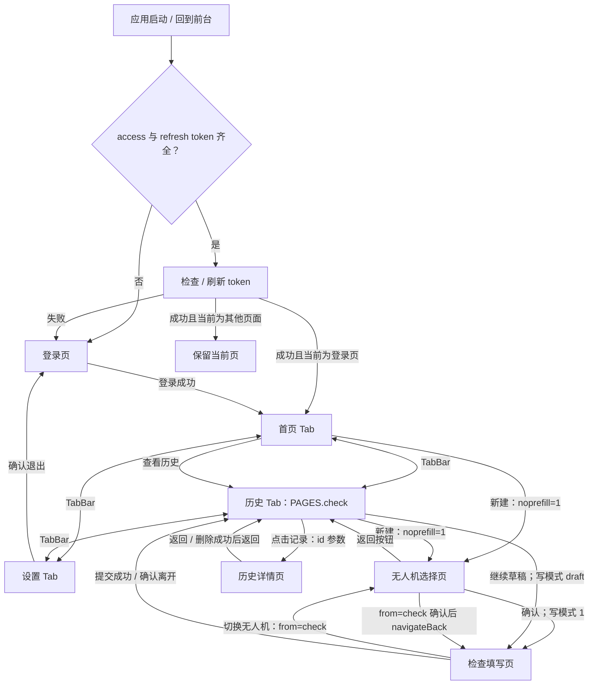
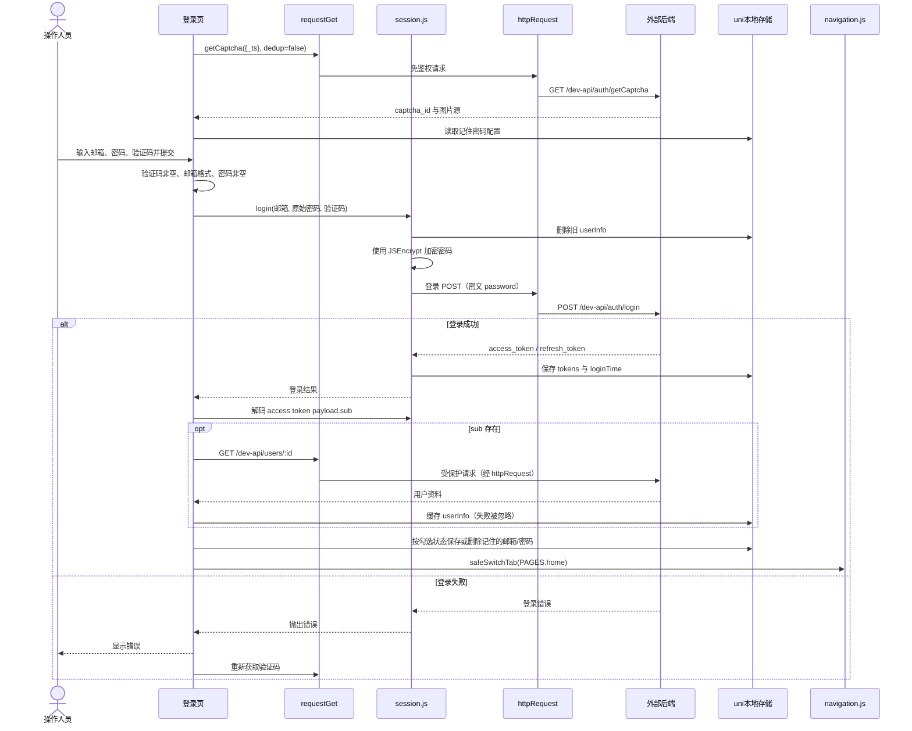
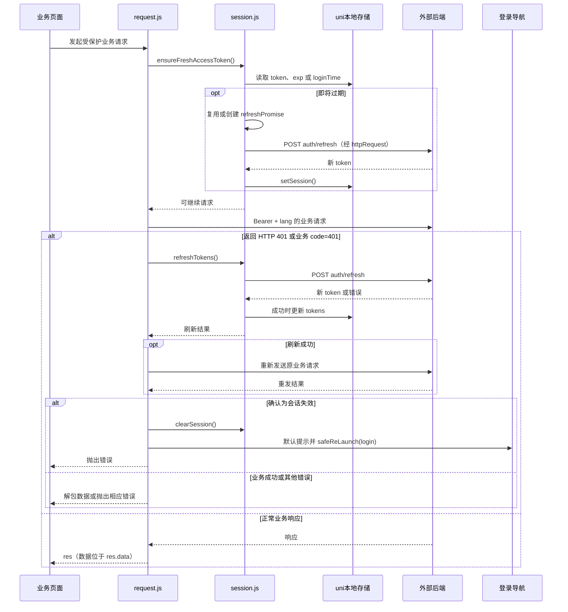
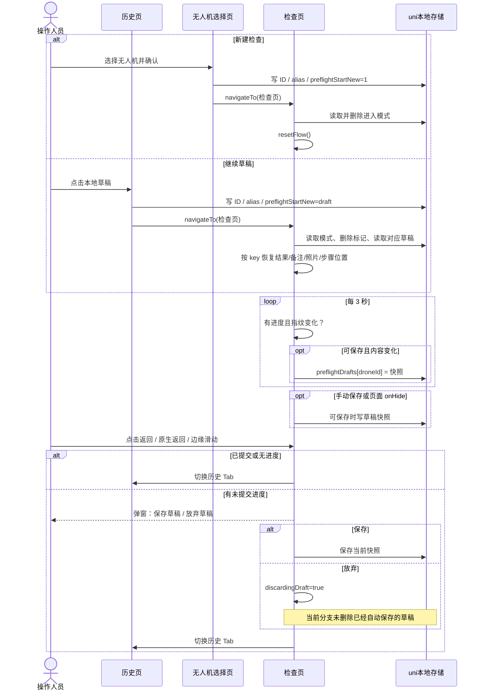
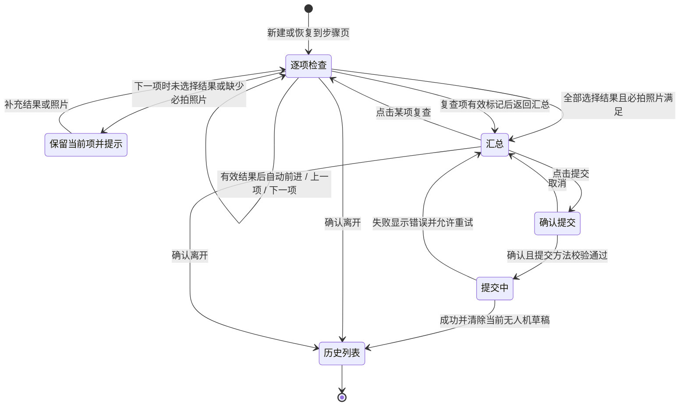
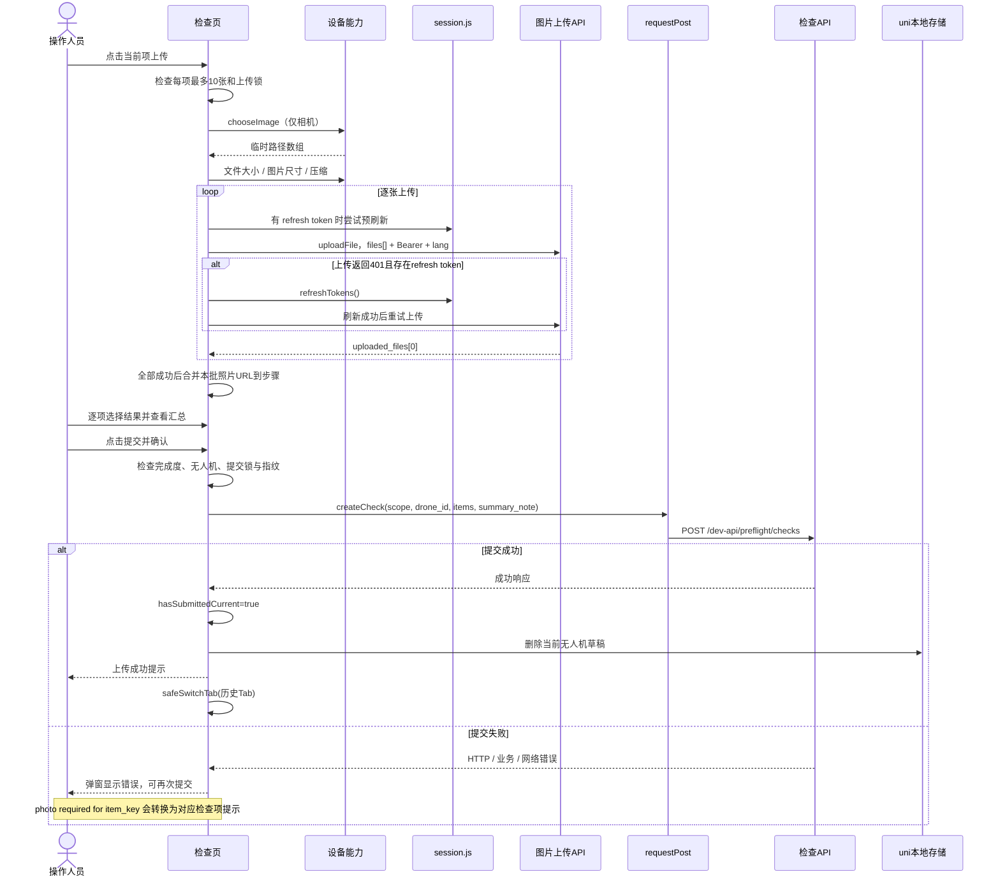
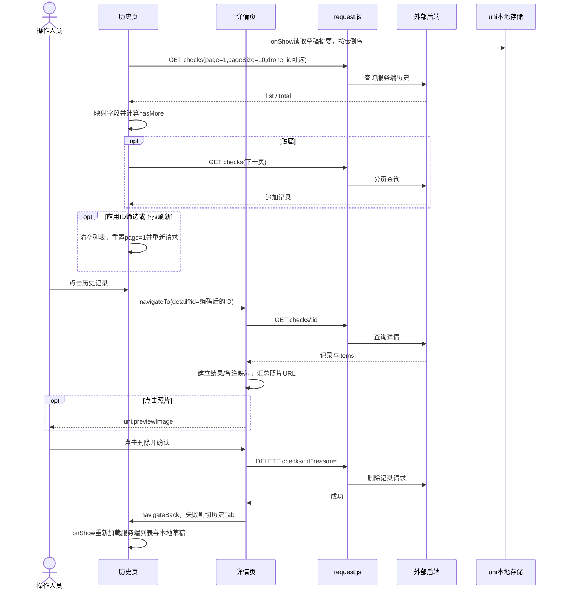

# 页面导航与交互流程

返回：[文档入口](./README.md)

## 1. 页面与操作入口

| 页面 | 路由常量 | 主要操作 |
| --- | --- | --- |
| 登录 | `PAGES.login` | 验证码刷新、登录、记住密码、中英文切换 |
| 首页 Tab | `PAGES.home` | 进入无人机选择、切换历史 Tab、语言切换 |
| 历史 Tab（标题为“检查”） | `PAGES.check` / `PAGES.preflightHistory` | 新建检查、草稿继续/删除、ID 筛选、历史详情、分页刷新 |
| 设置 Tab | `PAGES.settings` | 用户资料、头像预览、退出确认 |
| 无人机选择 | `PAGES.preflightSelectDrone` | 搜索、点击选择、底部确认；长按选择后弹出开始确认 |
| 检查填写 | `PAGES.preflightCheck` | 17 项结果/备注/照片、步骤切换、汇总、保存草稿、提交、切换无人机 |
| 历史详情 | `PAGES.preflightHistoryDetail` | 结果、逐项备注、图片预览、删除确认 |

`HeaderBar` 负责事件发出，由页面决定动作。通知是占位交互：设置页点击后显示“建设中”提示，首页隐藏通知；没有发现通知列表或未读数服务。Tab 切换由 `pages.json` 的原生 TabBar 提供。

## 2. 页面导航图

图中的详情返回表示常规入口；实现调用 `navigateBack`，失败时切历史 Tab。选择页自己的返回按钮固定切历史 Tab，即使从首页或检查页进入也是如此。直接设备返回与页面按钮的行为还受运行平台和页面栈影响。

导航封装会处理相同路由、忙状态和框架锁冲突；部分按钮还先检查 `isNavGuardActive()`。常见保护窗口为 450 ms，默认重试 2 次、间隔 120 ms，`safeReLaunch` 的默认间隔为 150 ms。保护用于抑制重复导航，不构成页面权限控制。

## 3. 登录与用户资料交互

登录后用户信息获取失败不会阻止进入首页。若本地密码加密失败，会在发送登录请求前直接抛错，登录页同样显示错误并刷新验证码。验证码图片支持完整 URL、以 `/` 开头的路径、Data URI 或裸 Base64；`normalizeCaptchaImageSrc` 不会为相对验证码路径自动拼接 API 主机。

## 4. 会话刷新交互

这是主路径说明。发送前刷新失败会直接清会话；401 后刷新失败的处理还取决于错误是否带有可识别的 401 响应。`request.js` 的外层 `catch` 存在额外重试分支；具体边界应通过请求 mock 或联调验证。`onUnauthorized` 自定义回调可以取代默认提示/导航。

## 5. 新建、恢复与切换无人机

| 进入方式 | 跨页状态 | 检查页行为 |
| --- | --- | --- |
| 首页/历史新建 | 选择页参数 `noprefill=1`；确认写 ID、alias 和 `'1'` | 检查页消费标记并 `resetFlow()`，不自动恢复同 ID 的旧草稿 |
| 历史继续草稿 | 历史页写 ID、alias 和 `'draft'` | `tryRestoreDraft()` 按 key 恢复；恢复失败则重置流程 |
| 检查页切无人机 | 参数 `from=check`；确认仅更新 ID/alias 并返回 | 原检查页 `onShow` 读取新 ID/alias；无新模式标记时保留现有步骤内容 |
| 普通返回检查页 | 无 `preflightStartNew` | 保留内存内容；若无选中无人机且无进度，尝试导航到历史页 |

最后一项的空状态分支实际调用 `safeNavigateTo(PAGES.preflightHistory)`；但历史页是 Tab，按 uni-app 导航语义应使用 `switchTab`，该分支可能导航失败，见风险文档。

## 6. 检查填写状态与规则

交互细节：

1. 点击“通过/不通过”先写入 `ok`，再检查必拍照片；缺照片会留在当前项，但 `ok` 已被记录。
2. 结果有效且照片满足时自动进入下一项；最后一项通过完整性检查后进入汇总。
3. 点击“下一项”不自动设结果；必须先明确选择 `true/false`。
4. 汇总可以点击某项复查；重新标记该项后回汇总。汇总中未选择结果的项会按假值显示为不通过，但提交按钮仍由 `flowCompleted` 禁用。
5. “保存草稿”要求已选无人机、有任意进度、当前未提交；不要求所有步骤完成。
6. “提交”按钮要求未上传、未提交中、当前未标记已提交且所有项已选择结果；不要求全部通过。
7. 检查页通过页面钩子、Vue 3 返回钩子、`plus.key` 原生监听和边缘触摸处理进入相同离开确认逻辑；`leavePrompting` 防止弹窗重复。实际手势行为需真机验证。

## 7. 拍照、上传与提交时序

上传和记录提交是两个独立请求阶段。上传批次任意一张失败时会跳出流程，当前代码静默捕获异常，本批已成功上传的 URL 也不会合并回步骤；提交失败则保留页面内容和已有照片 URL。

## 8. 历史、详情与删除时序

本地草稿删除走另一条路径：确认后删除 `preflightDrafts[droneId]` 并刷新摘要，不向后端发送 DELETE。详情删除失败没有页面级错误捕获；当前详情加载失败则把 `detail` 置空显示 `-`。

## 9. 设置与退出

设置页先展示本地缓存，再按 JWT `sub` 请求最新资料；头像支持多个兼容字段并可预览。点击退出需确认；页面调用 `session.logout()`，不论其抛错与否都会显示成功提示并跳登录。

`session.logout()` 在没有 refresh token 时直接清本地会话；有 refresh token 时等待退出接口返回后清理，再检查 HTTP 错误。如果请求在网络层直接 reject，清理语句不会执行。该边界会导致页面提示与实际本地状态不一致，见[风险与建议](./04-findings.md)。

## 10. 源码定位

| 交互 | 文件与分析时行号 |
| --- | --- |
| 首页入口 | [首页](../pages/index/index.vue)，73 |
| 登录与记住密码 | [登录页](../pages/login/login.vue)，112、164 |
| 无人机确认 | [选择页](../pages/preflightSelectDrone/preflightSelectDrone.vue)，265 |
| 草稿模式消费 | [检查页](../pages/check/check.vue)，557 |
| 离开拦截 | [检查页](../pages/check/check.vue)，326、654、712 |
| 步骤/汇总切换 | [检查页](../pages/check/check.vue)，929、981、1005 |
| 提交确认 | [检查页](../pages/check/check.vue)，1247、1328 |
| 草稿继续与删除 | [历史页](../pages/preflightHistory/preflightHistory.vue)，222、229 |
| 详情删除 | [详情页](../pages/preflightHistoryDetail/preflightHistoryDetail.vue)，224 |
| 退出确认与会话清理 | [设置页](../pages/settings/settings.vue)，138；[session.js](../common/session.js)，467 |
